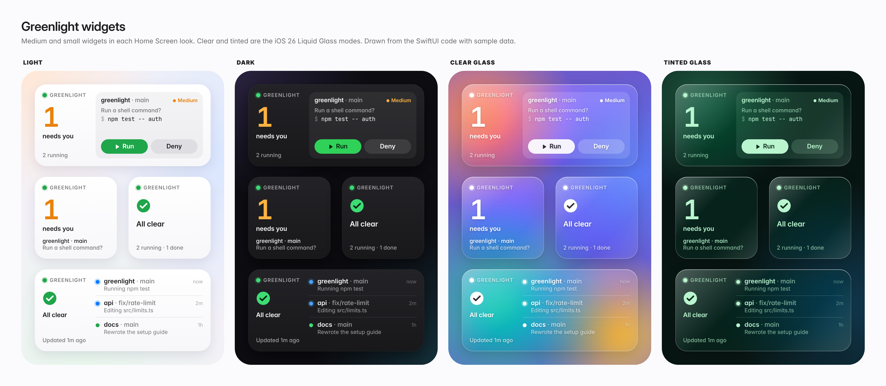
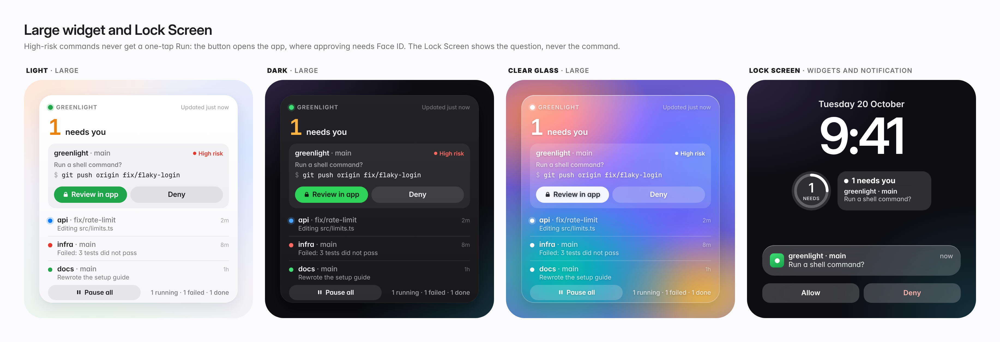

<div align="center">

# 🟢 Greenlight

**Your Claude Code sessions, on your iPhone's Home Screen.**<br>
See which session needs you, and give it the green light with one tap.






<sub>Mockups drawn from the widget's SwiftUI code with sample data. Clear and tinted are the iOS 26 Liquid Glass Home Screen looks.</sub>

</div>

## Why

You start Claude Code on a task, step away for coffee, and come back twenty minutes later to find it stopped after thirty seconds, waiting for you to say yes to `npm test`.

AI agents rarely get stuck because the work is hard. They get stuck because they're waiting for a person who isn't looking at the screen.

**Greenlight turns that wait into a two-second tap.** The widget on your iPhone shows what each session is doing, tells you when one needs you, and puts the exact command right there with **Run** and **Deny** buttons. Tap, and your session carries on.

## What you get

- 👀 **A glance tells you everything.** "1 needs you" or "All running", in a widget on your Home Screen or Lock Screen.
- ✅ **Approve from anywhere.** Run or deny a permission prompt from the widget or a notification, without touching your laptop.
- 🔎 **You always see the real thing.** The widget shows the exact command or file, never a vague summary.
- 🛡️ **Risky commands get a closer look.** `git push`, `rm -rf`, deploys and edits to secrets open a full review screen with Face ID instead of a one-tap button.
- ⏱️ **Silence never approves anything.** If you don't answer within two minutes, the normal prompt simply appears in your terminal.
- 🛑 **One kill switch.** **Pause all** stops every session from running tools until you turn it back on.
- 📜 **A record of every decision.** Every Run and Deny lands in an audit log.

## How it works

```
 Claude Code on your computer          Relay server              Your iPhone
 ────────────────────────────      ──────────────────      ──────────────────────
  "Can I run npm test?"     ──────▶  holds the question ──▶  widget + notification
                                                                     │
  carries on running        ◀──────  passes the answer  ◀──── you tap Run
```

Greenlight has three small parts:

| Part | Folder | What it does |
|---|---|---|
| **Claude Code plugin** | [`plugin/`](plugin/) | Uses Claude Code's built-in hooks to report what each session is doing and to forward permission prompts. No changes to Claude Code itself. |
| **Relay server** | [`relay/`](relay/) | A tiny TypeScript server you run yourself. It keeps session state, holds questions until you answer, and sends push notifications. No dependencies beyond Node. |
| **iOS app and widgets** | [`ios/`](ios/) | Home Screen and Lock Screen widgets with answer buttons, actionable notifications, and a small app for pairing, reviewing risky commands and settings. |

The relay runs on your own machine, so your commands and code never pass through anyone else's server.

## Try it in five minutes

No iPhone or Xcode needed. The relay comes with a phone simulator in your browser.

You need Node 22 (see [`.nvmrc`](.nvmrc)).

```sh
# 1. Start the relay. It prints a link to the phone simulator.
cd relay && npm ci && npm run dev

# 2. Open the "phone simulator" link it printed, e.g. http://localhost:8787/#token=...

# 3a. Watch a pretend session (no Claude Code needed):
GREENLIGHT_RELAY_URL=http://localhost:8787 node plugin/scripts/simulate-session.mjs

# 3b. Or run real Claude Code with the plugin:
GREENLIGHT_RELAY_URL=http://localhost:8787 claude --plugin-dir ./plugin
```

When Claude asks to run a command, the simulated widget shows it with **Run** and **Deny**. Tap one and Claude Code carries on without anyone touching the terminal.

<p align="center">
  
  &nbsp;&nbsp;
  
</p>
<p align="center"><sub>Left: a routine command, one tap. Right: a <code>git push</code> gets the full review sheet.</sub></p>

To put it on a real iPhone, follow [`ios/README.md`](ios/README.md). You'll need a Mac with Xcode 16 or later.

## Project status

Greenlight is an early prototype, built in the open.

| Piece | State |
|---|---|
| Relay server | ✅ Working, with unit and end-to-end tests in CI |
| Claude Code plugin | ✅ Working, tested against the real relay in CI |
| Browser phone simulator | ✅ Working |
| iOS shared library (models, relay client, widget rules) | ✅ Tested in CI |
| iOS app and widgets | 🚧 Code written, not yet built and run in Xcode on a device |

Phone approvals work for Claude Code sessions on your own computer. Claude Code in cloud sandboxes doesn't run hooks for permission prompts, so there Greenlight can show status but can't answer prompts.

**On the roadmap:** Live Activities and the Dynamic Island for the session that's running right now, letting Claude ask open questions with buttons, an Apple Watch complication, and support for agents beyond Claude Code. The relay protocol is already agent-neutral so others can plug in later.

## Learn more

- [`docs/design.md`](docs/design.md): the full design, from the user's moments to the safety rules
- [`docs/protocol.md`](docs/protocol.md): the wire format between agents, relay and phone
- [`docs/adr/`](docs/adr/): the key decisions and why we made them

## Contributing

Ideas, bug reports and pull requests are welcome. All changes go through pull requests to `main`; see [CONTRIBUTING.md](CONTRIBUTING.md) for the branch, commit and review rules.

Checks that CI runs:

```sh
cd relay && npm run check     # typecheck, format, unit + end-to-end tests
plugin/scripts/validate.sh    # plugin structure + unit tests
```
