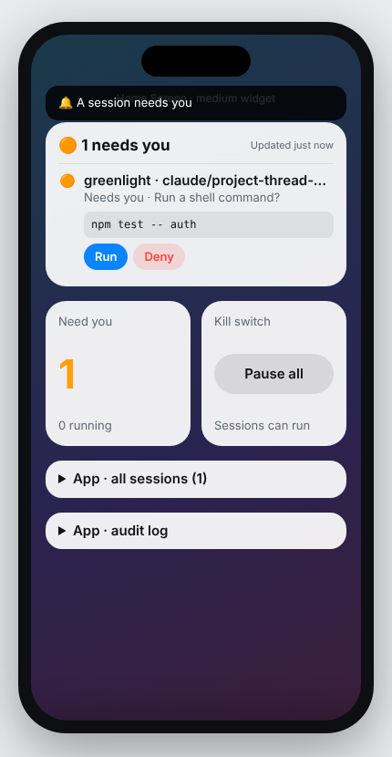
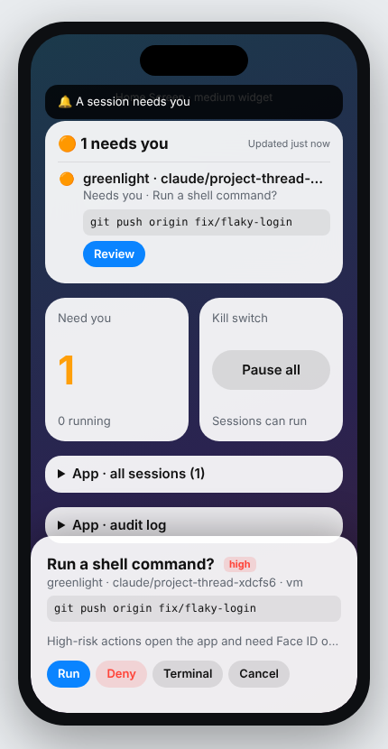

# Greenlight

See what your Claude Code sessions are doing from your iPhone, and approve their permission prompts with one tap.

Greenlight has three parts:

| Part | Folder | What it does |
|---|---|---|
| Claude Code plugin | [`plugin/`](plugin/) | Hooks that report session status and forward permission prompts to the relay. |
| Relay server | [`relay/`](relay/) | Small TypeScript server that stores session state, holds pending decisions and pushes to the phone. |
| iOS app | [`ios/`](ios/) | App, Home/Lock Screen widgets, Live Activities and actionable notifications. |

```
Claude Code session ──hooks──▶ relay ──APNs──▶ iPhone (widget, Live Activity, notification)
        ▲                                         │
        └──────────── allow / deny ◀──────────────┘
```

The scope for now is Claude Code sessions only. The relay protocol is kept agent-neutral so other agents can report in later. See [`docs/design.md`](docs/design.md) for the full design and [`docs/protocol.md`](docs/protocol.md) for the wire format.

## Try it in five minutes

Requirements: Node 22 (see `.nvmrc`). The iOS app needs Xcode 16+ on a Mac (see [`ios/README.md`](ios/README.md)).

```sh
# 1. Start the relay. It prints a phone simulator link and a pairing link for the iPhone app.
cd relay && npm ci && npm run dev

# 2. Open the "phone simulator" link it printed, e.g. http://localhost:8787/#token=...

# 3a. Watch a pretend session (no Claude Code needed):
GREENLIGHT_RELAY_URL=http://localhost:8787 node plugin/scripts/simulate-session.mjs

# 3b. Or run Claude Code with the plugin:
GREENLIGHT_RELAY_URL=http://localhost:8787 claude --plugin-dir ./plugin
```

When Claude asks to run a command, the widget shows the exact command with **Run** / **Deny**. Tap one and Claude Code carries on without anyone touching the terminal. If nobody answers within two minutes, the normal terminal prompt appears: silence never approves anything.

<p>
  
  
</p>

Checks (what CI runs):

```sh
cd relay && npm run check     # typecheck, format, unit + end-to-end tests
plugin/scripts/validate.sh    # plugin structure + unit tests
```

## Contributing

All changes go through pull requests to `main`. Read [CONTRIBUTING.md](CONTRIBUTING.md) for the branch, commit and review rules.
